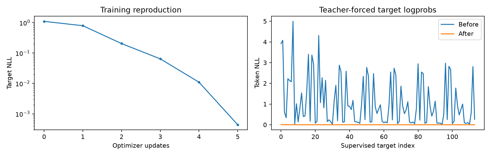
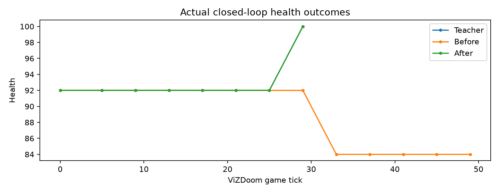

# Verification status — 2026-11-16

The executed notebook and plots under `assets/` are included for PR review. `training_runs/` contains generated runtime artifacts and is intentionally not committed; links to that directory refer to local/caradhras outputs. Full rollouts and trained weights remain at the server paths documented below.

## Actually run

- Local syntax/AST, notebook schema, Ruff checks.
- caradhras: genuine headless ViZDoom Health Gathering reset and six scripted actions;
  two independent seed-105 runs produced identical pixels and game state. These
  scripted actions are environment checks, not a teacher rollout or success example.
- Cached Qwen3.5-0.8B processor on real game frames: two-image tensors/grids, action
  token IDs, attention inputs, and native MRoPE shape validated without model weights.
- Real AsyncLLM CPU scheduler/recording with a logits stub and live ViZDoom: concurrent
  descriptor/thinker branches, actor checkpoints, forced-action bound, block append,
  clear/reuse, frame feedback, and target masking exercised.
- Tiny random multimodal HF model replay on that test trace: finite loss, nonzero
  vision gradients, and an actual optimizer update. This verifies plumbing only.
- 14 CPU tests passed on caradhras; 10 dependency-light tests passed locally.
- Notebook executed top to bottom on caradhras with real GPU artifacts, including
  embedded screenshots, the measured loss curve, and trajectory comparison.

CPU diagnostics and test logs are on caradhras under
`/home/mrozaeva/experiments/doom-health-overfit/repo/training_runs/doom_health/`.
The bundled `assets/initial.png` is an actual initial game screenshot. WAD/config
hashes and package versions are in `assets/environment.json`.

## Real GPU experiment

After the user clarified that shared GPU use was acceptable, all model stages ran
sequentially on physical GPU 1 alongside its existing process. Initial free memory
was approximately 65.7 GiB. No other processes were stopped. Native teacher inference
used about 10.4 GiB after initialization, including a fixed 0.50 GiB KV allocation.
Our PyTorch allocator was limited to 32 GiB (native Engine sets this after loading).
Training-stage peaks were 18.62 GiB allocated and 29.78 GiB reserved. Student inference
peaked at 2.82 GiB allocated / 2.94 GiB reserved.

- Teacher Qwen3.5-4B: 7 genuine live game actions, health 92 → 100, two Delta → H
  consolidations, subsequent reads from enlarged H; 114 supervised emitted tokens.
- Same-weight differentiable teacher replay: max absolute raw logprob error
  **0.0523427**, mean **0.00659493**, target argmax accuracy **100%**.
- Student Qwen3.5-0.8B before training: 12 `right` actions, no healing, health 92 → 84.
  Its own same-weight replay max error was **0.0111597**, mean **0.00175061**.
- Five full AdamW updates (FP32, LR 3e-6, vision parameters included): loss
  **1.10178125 → 0.00043609**, target accuracy **70.1754% → 100%**. Per-update
  losses: 1.10178137, 0.79256278, 0.20474631, 0.06430016, 0.01094513.
  Measured q_proj maximum parameter change: **1.5065074e-5**. Reloaded logits were
  exactly equal; an additional full-trajectory checkpoint reload check passed.
- Reloaded student free-running through real AsyncLLM and real ViZDoom: 7 `forward`
  actions, health 92 → 100. **All 114 role tokens matched the teacher** (44 descriptor,
  63 thinker, 7 actor), as did the checkpoint/consolidation schedule, game ticks,
  health, and exact post-action frame hashes. No teacher tokens/actions/history
  summaries/frames were inserted into student inference.

Teacher, student before/after, the blank-image control, frames, parity diagnostics,
comparison and training metrics are saved under `training_runs/doom_health/`.
The trained weights stay on caradhras in `trained/checkpoint/`; they are not copied
into the source tree. `comparison.json` records both trajectory success flags as true.

## Important limitation: visual dependence was not demonstrated

The teacher's short successful trajectory consists entirely of `forward` actions.
In a counterfactual student run, both model-input frames were replaced by black
images while the game continued executing the student's own actions. It produced
**the same 114 role tokens and the same seven actions**, still picking up the medkit.

Thus the saved short trajectory is genuinely reproduced without teacher forcing,
but this control does **not** demonstrate that the student needs new visual
observations. This is a successful trajectory-memorization test, not evidence of
general visual game understanding or observation-dependent steering. Stronger
validation needs a scenario where fresh observations disambiguate different actions;
the current notebook explicitly reports this limitation. Long-horizon survival,
unseen seeds, and the colleague's 64k/27B collection were not tested.

