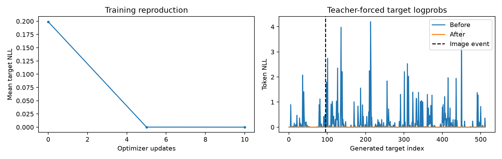

# Image steering overfit: проверенный результат

The executed notebook and plots under `assets/` are included for PR review. `training_runs/` contains generated runtime artifacts and is intentionally not committed; links to that directory refer to local/caradhras outputs. Full rollouts and trained weights remain at the server paths documented below.

Эксперимент выполнен на `caradhras`, GPU 0 (NVIDIA H100 80 GB), 16 ноября 2026.
Основной критерий выполнен: после загрузки обученного checkpoint студент через
настоящий AsyncLLM самостоятельно воспроизвёл **все 513 токенов teacher**.
Токены учителя не подавались в генерацию. Обновление изображения произошло после
ровно 96 сгенерированных токенов; совпали внешние события и обе части траектории.

[Выполненный notebook](image_steering_overfit.ipynb) содержит изображения, входы,
события, cache views, token-level inspection, replay checks, loss и свободные ответы.
[Helper](experiment.py) использует публичный `RecordedAsyncLLM` / `Trace.to` /
`replay_trace`, существующие record_sample, chunked loss и isolated processes.
Изменений библиотеки и нового training framework не потребовалось.

## Teacher и самостоятельные student rollouts

MathVista 45: август 17, сентябрь 20 в A и 14 в B. Правильный ответ меняется
с +3 на −3. Teacher — Qwen3.5-4B, student — Qwen3.5-0.8B.

| Запуск | Токены | Финал | Результат |
|---|---:|---|---|
| Teacher, A→B | 513 | −3, EOS | Прочитал 20 до события и 14 после, пересчитал разность |
| Student до обучения, A→B | 640 | Нет финального ответа | Прочитал 14, затем ошибочные пересчёты и исчерпание бюджета |
| Student после обучения, A→B | 513 | −3, EOS | Полное совпадение всех токенов teacher |
| Student после, без обновления | 466 | +3, EOS | Правильно использовал исходное A |
| Student после, A→A с тем же уведомлением | 513 | +3, EOS | Реакция зависит от новых pixels, а не только от уведомления |

До обучения общий префикс с teacher составлял 5 токенов,
positional agreement — 8.125%, sequence similarity — 0.3330.
После обучения все три token metrics равны 100% / 513 токенам.
Содержательные признаки оцениваются отдельно: старое 20 до события, новое 14 после,
пересчёт к −3 и EOS. Специальная фраза признания ошибки не требуется и не
выдаётся за семантическую метрику: teacher и итоговый student просто заново
считывают таблицу и рассчитывают правильную разность.

A→A контроль проверяет идентичность prompt/prefix/notification IDs, setup,
расписания внешнего события и исходных обработанных pixels. Меняются только pixels
во втором image block. Он прошёл: `pixel_control_low_lr.json`.

## Replay и реальное обучение

| Проверка | До image event | После image event | Общий максимум |
|---|---:|---:|---:|
| Teacher target logprob error | 0.03886381 | 0.06224346 | 0.06224346 |
| Student own-trace target logprob error | 0.00725830 | 0.01149899 | 0.01149899 |

Teacher replay использует FP16, student replay/training — FP32; inference — FP16.
Порог максимальной ошибки 0.1 взят из существующего overfit workflow.
Средние ошибки — 0.00114858 и 0.00080686.
Argmax совпал на 100% проверенных teacher и student токенов.
Это сравнение target logprobs и argmax; полное равенство всех vocabulary logits
не заявляется. Вероятности student не сравниваются с teacher на разных весах.

Проверены row-aligned labels, loss mask, порядок image requests, MRoPE,
видимые длины blocks, clear старого image block и сохранность reasoning cache.
Image block занимает 75 токенов, но rotary span равен 12: эти величины не
подменяются друг другом. Новый image block prefills только на prompt;
исторические reasoning KV не пересчитываются. При replay оба изображения
кодируются заново, GDN и attention используют сохранённые views.
Обработанные image tensors teacher/student проверены на идентичность.

Выбранный запуск: AdamW, LR 3e-6, FP32, vision tower заморожен, language weights
обновляются. Early stop после **10 шагов**, около 20.4 s непосредственно
training loop. Loss: **0.19900364 → 0.00008282**.
Teacher-forced accuracy: **92.9825% → 100%**.
Вероятность полной target sequence: **0.958405**.
Максимальное изменение отслеживаемого параметра: **2.83699483e-05**.
Ненулевые конечные gradients проверены на каждом шаге; после reload разница
training replay loss равна **0.0**.
Пиковая выделенная PyTorch память в training run — около 14.48 GiB.

## Файлы и воспроизводимость

Локальная рабочая копия:
`/Users/warri/codex-remote/image-steering-overfit`,
ветка `codex/image-steering-rollout-api`, база `training-internal-refactor`
(`33136eddd5d3b5f646ec88f5602baeae1a432cf0`). `main` не изменялся.

Серверная копия: `/home/mrozaeva/experiments/image-steering-overfit/repo`.
Исходники разрабатывались локально и синхронизировались через rsync без удаления.
Существующий `/home/mrozaeva/async_llm` не изменялся. GPU перед запуском были
проверены, чужие процессы не останавливались. Сейчас GPU свободны.

Все rollout JSON, training diagnostics, неудачные попытки и логи перенесены
локально в `training_runs/image_steering/` (без больших весов):

- [Teacher trace](../../../../training_runs/image_steering/teacher.json).
- [Student до обучения](../../../../training_runs/image_steering/student_before.json).
- [Student после обучения](../../../../training_runs/image_steering/student_after_low_lr.json).
- [Без обновления](../../../../training_runs/image_steering/student_without_update_low_lr.json).
- [A→A контроль](../../../../training_runs/image_steering/student_same_image_low_lr.json).
- [Training metrics](../../../../training_runs/image_steering/trained_low_lr/training.json).
- [Сравнение траекторий](../../../../training_runs/image_steering/comparison_low_lr.json).
- [Pixel control](../../../../training_runs/image_steering/pixel_control_low_lr.json).
- `teacher_parity.json`, `trained_low_lr/student_initial_parity.json`,
  `checkpoint_reload_low_lr.json`, `environment.txt`, `model_snapshots.json`.

Обученные веса остаются на сервере:
`/home/mrozaeva/experiments/image-steering-overfit/repo/training_runs/image_steering/trained_low_lr/checkpoint`.
Для нового эксперимента выбрать новый RUN в notebook. Итоговый notebook выполнен
сверху вниз с повторным использованием уже сохранённых и проверенных стадий;
teacher inference, оба training runs и student free generations реально
выполнялись отдельными GPU-процессами. Успешность не выводится только из кэша loss.

Зафиксированные model snapshots:

- Teacher: `851bf6e806efd8d0a36b00ddf55e13ccb7b8cd0a`.
- Student: `2fc06364715b967f1860aea9cf38778875588b17`.

Окружение: Python 3.12.3, torch 2.13.0+cu130, Transformers 5.14.1 для replay,
training и student inference. Teacher был записан на Transformers 5.12.1;
совпадение обработанных image tensors и inference/replay logprobs затем явно
проверено. Полный список пакетов — в environment.txt.

Локально прошли import helper, notebook schema/AST, Ruff и 8 acceptance tests.
На сервере итоговые CPU trace/recording/acceptance checks: **88 passed**.
Выполненный notebook: 24 ячейки, без ошибок выполнения.

## Ограничения и сохранённые отрицательные результаты

Это overfit одной задачи с фиксированным token-count trigger и greedy decoding.
Результат не доказывает обобщение на другие изображения, вопросы, времена
события или sampling seeds. Используется один генерирующий поток, без
thinker/writer switching probe из большого evaluator. Video understanding
в эту работу не входит.

Первый запуск с LR 3e-5 после 80 шагов тоже воспроизвёл все 513 токенов,
но давал −3 без B и после A→A. Он сохранён в `trained/` и JSON без суффикса
`_low_lr`; это отрицательный пример того, почему одного низкого loss и даже
точного совпадения основной траектории недостаточно для проверки визуальной
чувствительности. Выбранный LR 3e-6 прошёл оба контроля.

Также сохранены: неудачный inline-notification rollout с повторением сообщения,
траектория с лимитом 512 без EOS и логи первоначальной несовместимости
Transformers 5.12.1 с attention-mask dict нового replay API. Код использует
реальные интерфейсы выбранной training ветки; совместимость веток не предполагается.
