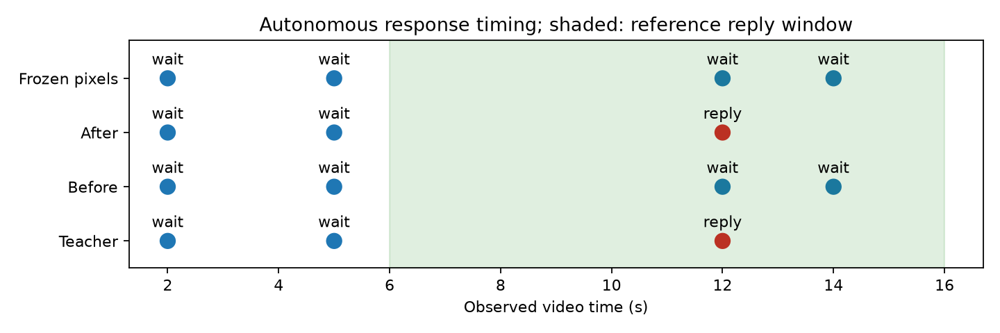
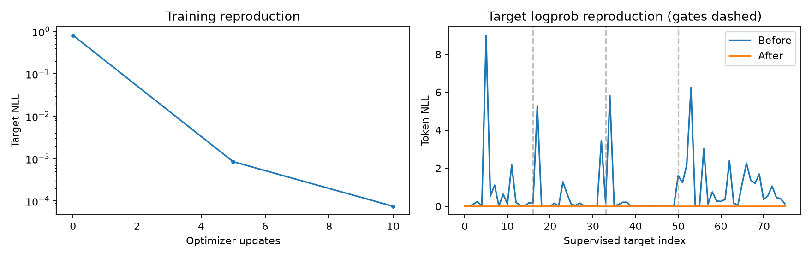

# Video-understanding overfit: реальный запуск

The executed notebook and plots under `assets/` are included for PR review. `training_runs/` contains generated runtime artifacts and is intentionally not committed; links to that directory refer to local/caradhras outputs. Full rollouts and trained weights remain at the server paths documented below.

Эксперимент выполнен 16 ноября 2026 на `caradhras`, NVIDIA H100 80 GB, GPU 0.
Создана отдельная worktree `/Users/warri/codex-remote/video-understanding-overfit`,
ветка `codex/video-understanding-overfit` от `training-internal-refactor`
(`33136eddd5d3b5f646ec88f5602baeae1a432cf0`). Main и image-steering эксперимент
не изменялись.

**Критерий самостоятельного воспроизведения выполнен:** после загрузки обученных
весов student через настоящий AsyncLLM воспроизвёл все **76 целевых токенов**
teacher: 48 thinker, 3 gate actions и 25 writer, включая EOS. Совпали внешние
события, решение о начале ответа и текст. Teacher tokens и teacher gate actions
в evaluation не подставлялись. Контроль с замороженными pixels также прошёл.

[Выполненный notebook](video_understanding_overfit.ipynb) — основной entry point.
[README](README.md) описывает интерфейсы, запуск и точный протокол.

## Реальная video-задача и исходная демка

Использован один клип ProactiveVideoQA/VAD: `Explosion016_x264.mp4`,
32.1 секунды, 4,523,207 bytes. Из публичного ZIP извлечён только этот файл через
HTTP ranges; большой датасет не скачивался. Dataset revision:
`7f59bce2a6cdf40b8a895767aac7a52a92136c5f`.
[Источник и аннотации](https://huggingface.co/datasets/wangyueqian/ProactiveVideoQA).

Вопрос — исходный вопрос датасета о подозрительных/опасных событиях.
Поток содержит кадры на 2, 5, 12 и 14 секундах. Окно ответа в аннотации — [6, 16].
На кадре 12s отчётливо виден дым у фасада здания. В inference попадают только
вопрос, timestamps и pixels, без имени видео, reference answer и окна ответа.
Полный manifest и SHA256 находятся в `assets/task.json`.
Исходный клип сохранён локально и на сервере в
`training_runs/video_understanding/source/Explosion016_x264.mp4`.

[Предоставленная демка](https://github.com/vovanbart/AsyncLLM-demo/tree/967a9074409566f2356aad98c9657ce0c6223521)
содержит rolling-пары previous/current frames, thinker, отдельный gate и writer.
В её единственной публичной ветке сейчас находится nuScenes source; адаптеров
SoccerNet/ProactiveVideoQA там нет. Старые прямые `block.clear()` заменены
записываемыми вызовами текущего `RecordedAsyncLLM`. Публичный rollout API
использован без изменения библиотеки.

Наблюдения поступают после каждых 16 emitted thinker tokens. Thinker cache
сохраняется; observation block заменяется. Gate сам выбирает yes/no по logits.
После yes writer самостоятельно пишет короткий ответ. Gate видит prompt и
текущую пару кадров, writer — также thinker. Расписание кадров внешнее и
фиксированное; расписание ответов выбирает модель.

## Before / after и visual control

| Запуск | Gate на 2 / 5 / 12 / 14 s | Ответ |
|---|---|---|
| Teacher Qwen3.5-4B | no / no / yes / завершён | Ответ в 12s, smoke/building/fire-or-explosion |
| Student Qwen3.5-0.8B до обучения | no / no / no / no | Пропустил событие, ответа нет |
| Student после обучения | no / no / yes / завершён | Ответ в 12s, полностью совпадает с teacher |
| Student, frozen pre-event pixels | no / no / no / no | Корректно продолжает ждать, ответа нет |

В frozen control после первых двух кадров повторяется последний pre-event
кадр. Timestamps, token quotas, prompt и gate policy остаются прежними.
Сравнение проверяет сами обработанные pixel tensors, а не только metadata.
Положительный ответ при 12s исчезает, когда новые visual evidence не поступают.
Это проверка зависимости от pixels, а не просто от номера кадра.

Совпадение после обучения: thinker **48/48**, gate **3/3**, writer **25/25**,
включая EOS; positional agreement и sequence similarity — 100%.
До обучения у thinker совпадали первые 5 токенов, positional agreement был 15.625%;
writer не запускался. Точное совпадение с teacher не отождествляется с совпадением
reference caption датасета: семантические признаки и timing проверены отдельно.

Caption teacher/student описывает дым из центральной части фасада и указывает
на пожар или взрыв. Для содержательной проверки используются явные признаки
smoke + building, отдельно fire/explosion language, корректный gate sequence,
окно ответа и EOS. Это небольшой task-specific scorer; общая semantic judge
и aggregate PAUC не заявляются.

Thinker ограничен 16 токенами на наблюдение и содержит незавершённые planning
fragments. Они показаны в notebook по кадрам. Не заявляется содержательная
полнота таких коротких рассуждений: visual grounding здесь демонстрируется
самостоятельными gate decisions, writer answer и visual control.

## Replay и обучение

В сохранённом teacher trace — 830 input rows, 83 request batches, 3 observation
requests с двумя изображениями в каждом и 76 supervised targets. Trace хранит
pixels, grids, token types, три оси MRoPE, rotary spans, ordered cache views,
visible lengths и clear operations. Реальные input conditions воспроизводятся
через `Trace.to` / `replay_trace`, включая старые observation versions,
сохранившиеся в истории thinker. Обычный последовательный causal replay
не используется.

Prefix/user/image/flush inputs имеют target -100. Targets сопоставляются с
forward rows, которые действительно породили thinker/gate/writer tokens.
При replay image features и GDN history вычисляются заново на текущих весах.
Использованы существующие load_student, chunked loss, recorder и isolated processes.

| Same-weight logprob check | Максимум ошибки | Средняя ошибка | Raw argmax target accuracy |
|---|---:|---:|---:|
| Teacher FP16 inference/replay | 0.02576131 | 0.00384569 | 98.6842% |
| Student FP16 inference / FP32 replay на собственном baseline | 0.00999880 | 0.00107881 | 97.0588% |

Порог максимальной target-logprob ошибки — 0.1. В JSON есть разбиение по каждой
паре frame/role. Raw argmax accuracy показана отдельно: thinker запрещает
control/EOS tokens, gate выбирает из yes/no spellings, а logprobs сохраняются
до этих ограничений по полному vocabulary. Кроме того, replay численно не
bitwise-identical inference. Точное совпадение всех vocabulary logits не
заявляется. Student на других весах не сравнивается с teacher logprobs.

Обучение: FP32 language parameters, замороженный vision tower, AdamW LR 3e-6,
gradient clipping, максимум 80 шагов. Early stop сработал через **10 шагов**
(около 22.1s training loop):

- Loss **0.81359303 → 0.00007500**.
- Teacher-forced target accuracy **78.9474% → 100%**.
- Произведение teacher-forced target probabilities **0.994316**.
- Максимальное изменение отслеживаемого параметра **2.81506218e-05**.
- Проверены finite nonzero gradients; peak allocated PyTorch memory около **14.48 GiB**.
- После reload разница teacher-forced loss **0.0**.

## Артефакты и повторный запуск

Серверный notebook:
`/home/mrozaeva/experiments/video-understanding-overfit/repo/scripts/minisgl_examples/training/video_understanding/video_understanding_overfit.ipynb`.

Kernel: `.venv/bin/python` в этой worktree. Окружение переиспользуется через
symlink на совместимую image-steering venv, без изменения пакетов. Source imports
и дочерние процессы явно используют PYTHONPATH новой worktree. Версии:
Python 3.12.3, torch 2.13.0+cu130, Transformers 5.14.1.
Model snapshots: teacher `851bf6e806efd8d0a36b00ddf55e13ccb7b8cd0a`,
student `2fc06364715b967f1860aea9cf38778875588b17`.

Для действительно нового обучения выбрать новый RUN в первой code cell.
Иначе notebook явно использует результаты из выбранного каталога. Стандартный
путь результатов: `training_runs/video_understanding/`:

- [Teacher rollout](../../../../training_runs/video_understanding/teacher.json).
- [Student до обучения](../../../../training_runs/video_understanding/student_before.json).
- [Student после](../../../../training_runs/video_understanding/student_after.json).
- [Frozen visual control](../../../../training_runs/video_understanding/student_freeze.json).
- [Training metrics](../../../../training_runs/video_understanding/trained/training.json).
- [Trajectory comparison](../../../../training_runs/video_understanding/comparison.json).
- `teacher_parity.json`, `trained/student_initial_parity.json`, `checkpoint_reload.json`.
- `environment.txt`, `model_snapshots.json`, diagnostic logs и PNG plots.

Все диагностические файлы и rollouts перенесены локально, без больших весов.
Checkpoint находится на сервере:
`/home/mrozaeva/experiments/video-understanding-overfit/repo/training_runs/video_understanding/trained/checkpoint`.

Локально прошли Ruff, notebook schema/AST и 9 acceptance tests. На сервере:
**89 CPU tests passed** (trace/recording + acceptance). Notebook содержит
22 ячейки, 12 code cells; выполнен сверху вниз без ошибок. Три figures содержат
настоящие image/png outputs, визуально проверены. Teacher, baseline, replay,
training и free-running student/control реально выполнялись GPU-процессами;
финальная проверка notebook повторно использует сохранённые артефакты.

## Границы результата

Это один ProactiveVideoQA пример с фиксированным расписанием кадров и greedy
политиками. Обобщение на новые видео, вопросы или расписания не проверялось.
Используется pull/token-count stream, без real-time dropping и измерения
wall-clock PAUC. Audio и native video tensors не используются: протокол
передаёт пары images, как исходная демка. Native temporal-video replay —
отдельная функция, которую текущая библиотека не заявляет.

SoccerNet-Caption в этом эксперименте не прогонялся. Для него нужны разрешённые
исходные видео и отдельный выбор события/разметки; защищённая raw-video раздача
описана на [официальной странице](https://www.soccer-net.org/data).
Полный benchmark, streaming captioning многих событий и semantic judging
не подменяются результатом одного overfit.
